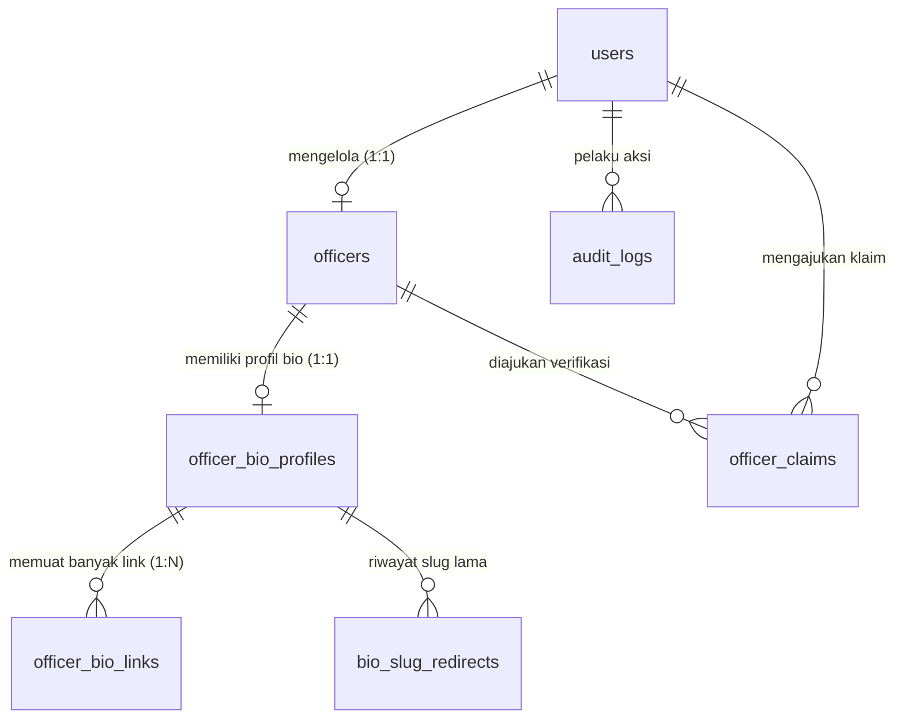
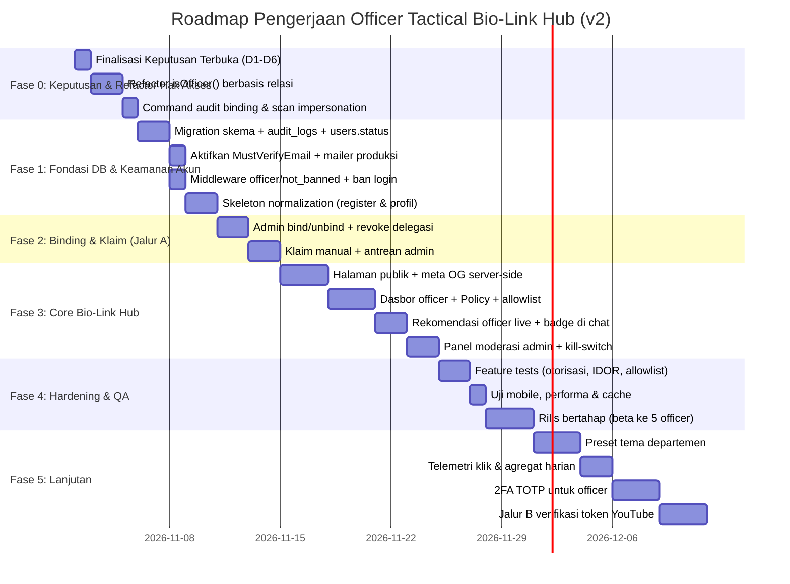

# PRD: Officer Tactical Bio-Link Hub & Anti-Impersonation System

**Proyek:** Police Tactical Command Center (SASP MotionLife RP)  
**Domain Produksi:** [https://policeduty.sasp-motionliferp.com/](https://policeduty.sasp-motionliferp.com/)  
**Target Pengguna:** Perwira Kepolisian (Streamer) & Komunitas Penonton  
**Status Dokumen:** Draft Revisi v2 — menunggu keputusan pada [Bagian 11](#11-keputusan-terbuka-open-decisions)  
**Status Implementasi:** 🟡 **Sebagian (± 70% backend MVP, UI admin belum ada)** — lihat [Bagian 12](#12-status-implementasi--hasil-validasi)  
**Tanggal:** 28 Oktober 2026

### Riwayat Revisi
| Versi | Tanggal | Perubahan |
| :--- | :--- | :--- |
| v1 | 28 Okt 2026 | Draft awal spesifikasi. |
| v2.1 | 28 Okt 2026 | Validasi implementasi terhadap kode di working tree (belum di-commit). Hasil di Bagian 12; checklist Bagian 10 diperbarui. |
| v2 | 28 Okt 2026 | Review teknis terhadap kode existing: model role berbasis relasi (bukan `users.role`), sumber slug tunggal + redirect, ancaman *account takeover* & allowlist domain, tabel audit log & status akun, otorisasi Policy/anti-IDOR, meta OG server-side, privasi analitik (HMAC + retensi), konsolidasi dengan `clipper_requests`, roadmap & acceptance criteria diperbarui. |

---

## 📑 Daftar Isi
1. [Ringkasan Eksekutif & Latar Belakang](#1-ringkasan-eksekutif--latar-belakang)
2. [Analisis Masalah & Arsitektur Bisnis](#2-analisis-masalah--arsitektur-bisnis)
3. [Model Ancaman & Protokol Keamanan](#3-model-ancaman--protokol-keamanan)
4. [Spesifikasi Fitur Utama (Product Specifications)](#4-spesifikasi-fitur-utama-product-specifications)
5. [Tata Kelola Data, Batasan Edit Mandiri & Kontrol Moderasi Admin](#5-tata-kelola-data-batasan-edit-mandiri--kontrol-moderasi-admin)
6. [Sistem Kustomisasi Bertahap (Extensibility & Theming)](#6-sistem-kustomisasi-bertahap-extensibility--theming)
7. [Perancangan Skema Database (Database Schema)](#7-perancangan-skema-database-database-schema)
8. [Arsitektur Rute, API & Otorisasi](#8-arsitektur-rute-api--otorisasi)
9. [Tahapan Implementasi & Roadmap Eksekusi](#9-tahapan-implementasi--roadmap-eksekusi)
10. [Kriteria Penerimaan (Acceptance Criteria)](#10-kriteria-penerimaan-acceptance-criteria)
11. [Keputusan Terbuka (Open Decisions)](#11-keputusan-terbuka-open-decisions)
12. [Status Implementasi & Hasil Validasi](#12-status-implementasi--hasil-validasi)

---

## 1. Ringkasan Eksekutif & Latar Belakang

Platform **Police Duty Multiview** (`https://policeduty.sasp-motionliferp.com/`) adalah pusat komando dan agregator siaran langsung perwira kepolisian di server MotionLife RP.

### Kebutuhan:
Perwira (streamer) membutuhkan sebuah halaman berbagi tautan (*Link-in-Bio*) resmi yang memuat:
- Tautan dukungan/donasi (*Saweria, Bagibagi, Trakteer, Sociabuzz*).
- Komunitas dan koordinasi (*Discord Pribadi, Discord Unit/Divisi*).
- Rekomendasi perwira lain (*Patrol Partners / Squad Streamers*) yang terintegrasi langsung dengan status LIVE.
- Media sosial dan tautan kustom lainnya.

### Visi Desain:
Alih-alih menggunakan layanan pihak ketiga yang generik (seperti Linktree), fitur ini menyatu dengan nuansa **Tactical Police Command**, memiliki badge verifikasi resmi kepolisian, dan ke depan dapat dikustomisasi secara modular oleh perwira bersangkutan tanpa merusak konsistensi desain sistem.

### Di Luar Cakupan (Non-Goals) v1:
- Verifikasi mandiri otomatis via YouTube (Jalur B) — dijadwalkan setelah MVP.
- Upload banner kustom (Fase 3 kustomisasi).
- Domain/subdomain kustom per perwira.

---

## 2. Analisis Masalah & Arsitektur Bisnis

### Kondisi Sistem Saat Ini (hasil audit kode)
| Komponen | Kondisi | Dampak ke Fitur Ini |
| :--- | :--- | :--- |
| `officers` | Diinput admin; `channel_id` unique, `handle` **tidak unique**, `callsign` hanya index. Punya kolom teks `department`/`rank` **dan** FK `agency_id`/`rank_id`/`division_id`. | Perlu sumber slug tunggal; perlu ditetapkan field resmi mana yang ditampilkan (lihat [Keputusan D3](#11-keputusan-terbuka-open-decisions)). |
| `users.role` | Satu nilai string: `member` / `officer` / `clipper` / `admin`. `isOfficer()` saat ini hanya mengecek role. | Role tunggal tidak bisa merepresentasikan "officer **dan** clipper". Menulis ulang role saat bind/unbind akan menimpa status lain. |
| `clipper_requests` | Memiliki `request_type = 'officer'` + `channel_url` — praktis sudah berupa klaim perwira. `approve()` menimpa role menjadi `clipper`. | Tumpang tindih dengan `officer_claims`; approve clipper dapat menghapus status officer. |
| `clipper_delegations` | Officer dapat mendelegasikan akses clipper ke user lain. | Saat unbind, delegasi yang diberikan officer tersebut harus ikut dicabut. |
| Chat (`chat_messages`) | Menampilkan `users.name` ke publik. | Di sinilah peniruan nama paling berdampak — bukan di bio-link. |
| Verifikasi email | `User` belum mengimplementasikan `MustVerifyEmail` (masih dikomentari); session driver `database`. | Verifikasi email + konfigurasi mailer produksi harus diaktifkan sebelum Lapis 4 berlaku. Driver `database` memudahkan pemutusan sesi saat ban. |

### Solusi Arsitektur (1-to-1 Bound Architecture)
- **Tabel `officers` tetap menjadi sumber kebenaran tunggal (*Single Source of Truth*)** untuk data dinas.
- Menambahkan kolom `user_id` yang bersifat `NULLABLE` dan `UNIQUE` pada tabel `officers`.
  - `user_id IS NULL`: Perwira berstatus **Unclaimed** (hanya dikelola Admin di roster).
  - `user_id = {id}`: Perwira sah dikelola oleh akun streamer yang telah diverifikasi.
- Satu user hanya boleh terikat ke satu perwira, dan satu perwira hanya memiliki satu akun pengelola (dijamin constraint `UNIQUE`, bukan hanya validasi aplikasi).

### Model Hak Akses: Status Officer Diturunkan dari Relasi
Status officer **tidak lagi disimpan di `users.role`**, melainkan diturunkan dari relasi:

```php
// App\Models\User
public function officer(): HasOne { return $this->hasOne(Officer::class); }

public function isOfficer(): bool
{
    return $this->isAdmin() || $this->officer()->exists();
}
```

- `users.role` hanya bermakna untuk `member`, `clipper`, `admin`. Bind/unbind **tidak pernah** menyentuh `users.role`.
- Approve clipper tidak lagi bisa "menghapus" status officer, dan unbind tidak lagi bisa menghapus status clipper atau men-demote admin.
- **Masa transisi:** selama backfill belum selesai, `isOfficer()` juga menerima `role === 'officer'` (legacy). Disediakan command `officers:audit-bindings` yang menampilkan user `role=officer` yang belum terikat ke officer mana pun, agar admin bisa melakukan binding manual. Setelah daftar kosong, cabang legacy dihapus dan role `officer` dimigrasikan menjadi `member`.
- **`clipper_requests` tipe `officer` dihentikan (deprecated)**: officer yang sudah terikat otomatis mendapat tier clipper officer. Form clipper request untuk tipe officer diarahkan ke alur klaim (lihat [Keputusan D4](#11-keputusan-terbuka-open-decisions)).



---

## 3. Model Ancaman & Protokol Keamanan

Situs ini terbuka untuk umum dan siapapun bisa mendaftar akun. Ancaman diurutkan berdasarkan dampak terhadap penonton (uang donasi):

| # | Ancaman | Dampak | Mitigasi Utama |
| :--- | :--- | :--- | :--- |
| T1 | **Account Takeover**: akun officer asli dibobol, link Saweria diganti ke milik penipu. | **Tertinggi** — halaman resmi berbadge verified mengarahkan donasi ke penipu. | Lapis 4 (keamanan akun) + Lapis 5 (integritas link). |
| T2 | **Claim Squatting**: penipu mengklaim profil perwira yang belum diklaim. | Tinggi | Lapis 1 + Lapis 3 (binding hanya oleh admin pada v1). |
| T3 | **Phishing / konten ilegal** di link kustom (judi online, scam, `javascript:`). | Tinggi | Lapis 5 + moderasi admin. |
| T4 | **Homoglyph & Typosquatting**: user meniru nama perwira (`rangerimutlucu` → `rangerimutIucu`) di chat / tampilan publik. | Sedang | Lapis 2 + badge verified di chat. |
| T5 | **IDOR**: officer A mengubah/menghapus link milik officer B via ID. | Tinggi | Policy otorisasi (Bagian 8). |

```
┌────────────────────────────────────────────────────────────────────────┐
│                   LAPISAN KEAMANAN IDENTITAS                           │
├────────────────────────────────────────────────────────────────────────┤
│ LAPIS 1: Closed-Loop URL                                               │
│          Slug Bio-Link hanya dibentuk dari Master Data Admin           │
├────────────────────────────────────────────────────────────────────────┤
│ LAPIS 2: Normalisasi Nama & Deteksi Homoglif (Skeleton Matching)       │
│          Berlaku saat register DAN saat ubah nama profil               │
├────────────────────────────────────────────────────────────────────────┤
│ LAPIS 3: Verifikasi Kepemilikan (Claim Verification)                   │
│          v1: Admin Manual Binding  |  Lanjutan: Token YouTube          │
├────────────────────────────────────────────────────────────────────────┤
│ LAPIS 4: Keamanan Akun Officer (Anti Account-Takeover)                 │
│          Email terverifikasi wajib, 2FA, notifikasi perubahan sensitif │
├────────────────────────────────────────────────────────────────────────┤
│ LAPIS 5: Integritas Tautan (Link Integrity)                            │
│          Allowlist domain, https-only, audit perubahan link donasi     │
├────────────────────────────────────────────────────────────────────────┤
│ LAPIS 6: Segel Verifikasi (Official Verification Seal)                 │
│          Badge resmi di bio-link DAN di chat                           │
└────────────────────────────────────────────────────────────────────────┘
```

### Lapis 1: Closed-Loop Slug Generation
- Pengguna umum **TIDAK MEMILIKI** tombol atau izin untuk membuat URL baru.
- **Sumber slug tunggal:** `officer_bio_profiles.slug`. Saat profil dibuat, slug diturunkan dari `officers.handle` (tanpa `@`, lowercase). Setelah itu slug **hanya bisa diubah oleh admin** dan tidak otomatis mengikuti perubahan `handle`.
- Aturan slug: regex `^[a-z0-9](?:[a-z0-9._-]{1,38}[a-z0-9])$`, unique (case-insensitive), dan tidak boleh termasuk daftar *reserved slugs* (`admin`, `api`, `dashboard`, `login`, `register`, `officers`, `multiview`, `clipper`, `sasp`, `lspd`, `bcso`, `sapr`, dsb.).
- **Redirect slug lama:** setiap perubahan slug menyimpan slug lama ke `bio_slug_redirects` dan menghasilkan redirect **301** ke slug baru, sehingga link yang sudah tersebar di deskripsi stream tidak mati. Slug lama tidak dapat dipakai officer lain selama 90 hari.
- Format URL: `https://policeduty.sasp-motionliferp.com/@{slug}`.
- **Officer unclaimed**: lihat [Keputusan D1](#11-keputusan-terbuka-open-decisions). Rekomendasi: halaman tetap ada dengan data roster + status live, **tanpa** link donasi/kustom dan tanpa badge verified.

### Lapis 2: Normalisasi Nama & Deteksi Homoglif
Diterapkan di `RegisteredUserController` **dan** `ProfileController@update` (ubah nama), karena tanpa yang kedua, cek saat register bisa dilewati.

1. **Skeleton normalization** (fungsi `NameSkeleton::make()`):
   - Unicode NFKC, lalu hapus karakter zero-width / kontrol (`\p{Cf}`, `\p{Cc}`).
   - Transliterasi karakter confusable non-Latin (Cyrillic `а`→`a`, Yunani `ο`→`o`, dsb.) memakai tabel confusables Unicode (`Spoofchecker` dari ext-intl bila tersedia).
   - Lowercase, lalu peta homoglif: `I`/`1`/`|` → `l`, `0` → `o`, `rn` → `m`, `vv` → `w`, `5` → `s`.
   - Hapus spasi, titik, underscore, dan tanda hubung.
2. **Aturan blokir:**
   - **Blokir** jika skeleton nama pendaftar **sama persis** dengan skeleton `officer_name`, `streamer_name`, atau `handle` milik officer aktif.
   - **Tandai untuk review** (bukan blokir) jika jarak Levenshtein antar-skeleton ≤ 1 dan panjang skeleton ≥ 6. Nama pendek tidak diuji fuzzy karena tingkat salah-tangkapnya tinggi.
   - Pengecualian: user yang terikat ke officer tersebut boleh memakai nama itu.
   - Pesan penolakan: *"Nama yang Anda gunakan menyerupai nama perwira kepolisian terdaftar. Silakan gunakan nama lain atau hubungi Admin jika Anda adalah perwira bersangkutan."*
3. **Reserved Keywords** (cek terhadap skeleton): `admin`, `sasp`, `lspd`, `bcso`, `sapr`, `command`, `moderator`, `official`, `dispatch`.
4. **Data existing:** command `users:scan-impersonation` menjalankan aturan di atas terhadap user yang sudah terdaftar dan menghasilkan daftar untuk ditinjau admin (tidak memblokir otomatis).
5. **Catatan:** Lapis 2 hanyalah lapis pendukung. Pertahanan yang lebih efektif adalah **badge verified di chat** (Lapis 6), sehingga penonton belajar memercayai badge, bukan nama.

### Lapis 3: Protokol Klaim Akun (Verification Proofs)

#### Jalur A: Direct Binding oleh Admin (Jalur Standar — v1)
- Admin memilih user dan officer di menu Admin:
  `Hubungkan User [ID: 8 - Budi] -> Officer [SASP 101 - Budiman]`.
- Bind dijalankan dalam transaksi DB dengan row lock pada officer; constraint `UNIQUE(user_id)` mencegah dua binding paralel.
- Saat bind: profil bio dibuat (jika belum ada) dan aksi dicatat di `audit_logs`.
- Syarat user yang dapat di-bind: email terverifikasi dan status akun `active`.
- User juga dapat mengajukan klaim (`officer_claims`, metode `manual_admin`) yang masuk ke antrean admin, sehingga admin tidak perlu mencari user secara manual.

#### Jalur B: Secret Token YouTube Verification (Fase Lanjutan)
1. Streamer login, memilih profil perwira dari daftar *Unclaimed Officers*.
2. Sistem menerbitkan token acak ber-entropi tinggi, contoh: `SASP-VERIFY-7KQ2-M9XD-4FTA` (≥ 64 bit). Yang disimpan di DB hanya **hash** token. Berlaku **24 jam** (perubahan deskripsi channel bisa terlambat terbaca oleh API).
3. Streamer menempelkan token di **deskripsi channel YouTube** (About) atau deskripsi siaran live.
4. Sistem memeriksa via YouTube Data API v3 (`channels.list?part=snippet` / `videos.list?part=snippet`) **memakai `officers.channel_id` dari master data admin** — URL channel yang dikirim user tidak pernah dipakai sebagai sumber verifikasi.
5. Token ditemukan → klaim **disetujui otomatis** dan dicatat di audit log, lalu admin menerima notifikasi.
6. Batasan: maksimal **1 klaim pending per officer** dan **1 klaim pending per user**; rate limit pengecekan 5×/jam per klaim.

### Lapis 4: Keamanan Akun Officer (Anti Account-Takeover)
- **Wajib email terverifikasi** sebelum bisa di-bind atau mengelola bio-link.
- **2FA (TOTP)** untuk akun yang terikat officer — lihat [Keputusan D2](#11-keputusan-terbuka-open-decisions) apakah wajib sejak v1 atau bertahap.
- **Re-autentikasi** (konfirmasi password) sebelum aksi sensitif: menambah/mengubah link donasi, mengganti email.
- **Notifikasi** ke email officer ketika link donasi berubah atau ada login dari perangkat baru.
- Ganti password atau ban akun → semua sesi lain diputus (`Auth::logoutOtherDevices` / hapus baris di tabel `sessions`).

### Lapis 5: Integritas Tautan (Link Integrity)
- **Skema URL:** hanya `https://`. Tolak `http:`, `javascript:`, `data:`, `vbscript:`, `file:`, dan URL dengan kredensial (`user@host`).
- **Allowlist domain per tipe link** (dicek terhadap host hasil `parse_url`, termasuk subdomain resmi):

| `link_type` | Domain yang diizinkan |
| :--- | :--- |
| `donation` | `saweria.co`, `bagibagi.co`, `trakteer.id`, `sociabuzz.com` |
| `discord` | `discord.gg`, `discord.com` |
| `social` | `youtube.com`, `youtu.be`, `tiktok.com`, `instagram.com`, `x.com`, `twitter.com`, `twitch.tv`, `facebook.com` |
| `officer_recommendation` | Tidak ada URL; target berupa `recommended_officer_id`. |
| `custom` | Bebas, kecuali domain pada **denylist** (judi, shortener seperti `bit.ly`/`s.id`, domain yang pernah di-ban admin). |

- **Perubahan link donasi** (tambah atau ubah URL) selalu dicatat di `audit_logs` dengan nilai sebelum/sesudah, memicu notifikasi ke admin dan ke email officer, dan tunduk pada kebijakan [Keputusan D5](#11-keputusan-terbuka-open-decisions) (langsung aktif vs. review).
- Semua link keluar dirender dengan `rel="noopener noreferrer nofollow ugc"` dan `target="_blank"`.
- Batas jumlah: maksimal **30 link** per profil, maksimal **4 rekomendasi officer**.

### Lapis 6: Segel Verifikasi (Official Verification Seal)
- Halaman bio-link yang terikat dan tidak di-suspend menampilkan:
  `[🛡️ VERIFIED SASP OFFICER | BADGE #4402]`
- **Badge yang sama ditampilkan di chat** (TacticalChatDrawer) di samping nama user yang terikat officer.
- Watermark domain `policeduty.sasp-motionliferp.com` di footer halaman bio-link.

---

## 4. Spesifikasi Fitur Utama (Product Specifications)

### 4.1 Halaman Publik Bio-Link (`/@{slug}`)
- **Header Identitas Perwira**:
  - Foto Avatar (dari `officers.avatar_url` hasil sinkronisasi YouTube).
  - Nama Panggung Streamer & Nama Karakter In-Game.
  - Badge Pangkat, Departemen, dan Nomor Callsign (sumber field: [Keputusan D3](#11-keputusan-terbuka-open-decisions)).
  - **Live Duty Status Bar**: badge merah berdenyut `🔴 SEDANG PATROLI (LIVE)` + judul siaran dan tombol *"Buka di Multiview"*. Status live dibaca dari `active_streams` yang sudah ada (tanpa panggilan YouTube baru per pengunjung).
- **Blok Tautan Modular (Link Sections)**:
  1. **Donasi** (Saweria, Bagibagi, Trakteer, Sociabuzz): kartu khusus dengan efek glowing taktis dan sub-teks (misal: *"Minimal 10k TTS On"*).
  2. **Komunitas & Sosial Media**: Discord, YouTube, TikTok, Instagram, X.
  3. **Rekomendasi Rekan Patroli**: 1–4 perwira rekanan dengan status Live/Offline; pengunjung dapat pindah siaran atau menambahkan rekan ke Multiview. Rekan yang nonaktif atau bio-nya di-suspend otomatis disembunyikan.
  4. **Tautan Kustom**: judul, sub-judul, URL, ikon, dan badge promo (*NEW / REKOMENDASI*).
- **Meta Tag & Preview Link (wajib):** halaman ini akan banyak dibagikan di Discord/WhatsApp/X. Karena aplikasi memakai Inertia tanpa SSR, meta `og:title`, `og:description`, `og:image`, `twitter:card`, dan `<link rel="canonical">` **dirender di server** (Blade root view memakai data dari controller), bukan hanya lewat `<Head>` di Vue.
- **Status halaman:**
  - Profil di-suspend → kartu `⚠️ HALAMAN DINONAKTIFKAN SEMENTARA OLEH KOMANDO KEPOLISIAN SASP`, tanpa link apa pun, HTTP 200 dengan `noindex`.
  - Profil disembunyikan oleh officer, atau officer `is_active = false` → HTTP 404.
  - Slug lama → 301 ke slug aktif.
- **Performa:** halaman di-cache (data profil + link) selama 60 detik, dengan invalidasi saat link/profil berubah; status live diambil terpisah via polling ringan ke `/api/v1/streams`.

### 4.2 Halaman Pengelolaan Tautan Perwira (`/dashboard/bio-links`)
- Akses: user yang terikat officer (`isOfficer()` berbasis relasi) atau admin.
- **Fitur Dasbor**:
  - Ubah Tagline / Bio Singkat.
  - Manajemen Daftar Tautan: tambah (pilih tipe), toggle aktif/nonaktif, reorder drag & drop, pemilih officer rekanan.
  - Validasi allowlist ditampilkan inline di form (pesan jelas domain apa yang diterima).
  - Pratinjau Langsung (*Real-time Mobile Preview Frame*).
  - Statistik Ringkas: klik per tautan & tayangan halaman (7/30 hari).
  - Riwayat perubahan link milik sendiri (dari `audit_logs`), sehingga officer bisa menyadari jika ada perubahan yang tidak ia lakukan.
- Saat profil di-suspend: dasbor read-only dengan banner alasan suspend.

---

## 5. Tata Kelola Data, Batasan Edit Mandiri & Kontrol Moderasi Admin

Untuk menjaga integritas data kepolisian dan mencegah penyalahgunaan tautan (link phishing, judi online, atau perwira yang diberhentikan dari RP), sistem menerapkan pemisahan wewenang yang tegas antara **Perwira (Streamer)** dan **Administrator SASP**.

### 5.1 Matriks Batasan Edit Data (Field Mutability Matrix)

| Kategori Data | Contoh Field | Dapat Diedit Officer? | Wewenang Admin | Alasan Tata Kelola |
| :--- | :--- | :---: | :---: | :--- |
| **Dinas Kepolisian Resmi** | Callsign, Badge #, Rank, Agency, Channel ID | ❌ **TERKUNCI** | ✅ **Penuh** | Data registri komando resmi in-game RP. |
| **Slug URL Publik** | `slug` | ❌ **TERKUNCI** | ✅ **Penuh** (otomatis membuat redirect 301) | Mencegah perebutan/penyalahgunaan URL. |
| **Profil & Tampilan Publik** | Tagline/Bio, Tema, Accent Color | ✅ **Bebas** | ✅ **Bisa Timpa** | Personalisasi estetika streamer. |
| **Tautan Donasi** | Saweria, Bagibagi, Trakteer, Sociabuzz | ✅ Dengan re-auth + allowlist + audit | ✅ **Bisa Hapus/Sensor** | Titik serangan utama account takeover. |
| **Tautan Lain** | Discord, Sosmed, Custom | ✅ **Bebas** (allowlist/denylist) | ✅ **Bisa Hapus/Sensor** | Fleksibilitas streamer. |
| **Status Publikasi Halaman** | Toggle Aktifkan Bio-Link | ✅ **Bisa Hide** | ✅ **Kill-Switch Mutlak** | Officer menyembunyikan sementara; Admin membekukan paksa. |

> [!NOTE]
> Pembaruan pangkat atau perpindahan departemen dilakukan Admin di menu **Officer Management** dan otomatis tercermin di halaman bio-link publik (cache halaman diinvalidasi).

### 5.2 Prioritas Status (Status Precedence)
Ada beberapa flag yang saling berkaitan. Urutan evaluasi untuk halaman publik:

| Urutan | Kondisi | Hasil Halaman Publik |
| :---: | :--- | :--- |
| 1 | `officers.is_active = false` (dihapus dari roster aktif) | 404 |
| 2 | `officer_bio_profiles.is_suspended = true` | Kartu "Dinonaktifkan oleh Komando" |
| 3 | `officer_bio_profiles.is_active = false` (disembunyikan officer) | 404 |
| 4 | `officers.user_id IS NULL` (unclaimed) | Halaman roster dasar tanpa link (lihat D1) |
| 5 | Normal | Halaman lengkap + badge verified |

`officers.duty_status = 'Suspended'` adalah status **in-game** (roleplay) dan **tidak** memengaruhi halaman bio-link; hanya ditampilkan sebagai badge status dinas.

### 5.3 Fitur Kendali & Moderasi Admin (Admin Moderation & Kill Switch)

Admin dibekali panel di `/admin/officers` dan `/admin/bio-links` dengan 4 tingkat penindakan. **Setiap tindakan wajib menyertakan alasan dan dicatat di `audit_logs`.**

```
┌────────────────────────────────────────────────────────────────────────┐
│                   TINGKATAN PENINDAKAN ADMIN                           │
├────────────────────────────────────────────────────────────────────────┤
│ LEVEL 1: Nonaktifkan / Hapus Tautan Tertentu (Single Link Purge)       │
├────────────────────────────────────────────────────────────────────────┤
│ LEVEL 2: Pembekuan Halaman Bio-Link (Kill-Switch / Suspension)         │
├────────────────────────────────────────────────────────────────────────┤
│ LEVEL 3: Putus Ikatan Akun (Revoke Binding / Force Unclaim)            │
├────────────────────────────────────────────────────────────────────────┤
│ LEVEL 4: Banned Akun Pengguna (Account Freeze)                         │
└────────────────────────────────────────────────────────────────────────┘
```

#### Tindakan 1: Nonaktifkan / Hapus Tautan Ilegal
- Admin dapat melihat seluruh tautan semua perwira, dengan filter `moderation_status`, tipe, dan domain.
- Aksi: `[NONAKTIFKAN LINK]` (set `moderation_status = 'banned'` + `moderation_reason`) atau `[HAPUS PERMANEN]`.
- Officer **tidak dapat** mengaktifkan kembali link berstatus `banned`.
- Opsi **"Ban domain ini"**: menambahkan host ke denylist global sehingga officer lain juga tidak bisa memakainya.

#### Tindakan 2: Emergency Kill-Switch
- Saklar `[🔴 SUSPEND BIO-LINK]` dengan alasan wajib.
- Efek seketika (cache halaman diinvalidasi):
  - Halaman publik hanya menampilkan kartu `⚠️ HALAMAN DINONAKTIFKAN SEMENTARA OLEH KOMANDO KEPOLISIAN SASP`.
  - Endpoint redirect klik untuk semua link profil ini berhenti me-redirect.
  - Officer tidak dapat menambah/menyunting link sampai suspend dicabut.

#### Tindakan 3: Pemutusan Hubungan Akun (Revoke Binding / Dishonorable Discharge)
Jika streamer keluar dari kesatuan (Resign, Pensiun, Dipecat), admin menekan `[PUTUS HUBUNGAN / UNBIND AKUN]`. Dalam satu transaksi:
1. `officers.user_id = NULL` (profil kembali **Unclaimed**).
2. `officer_bio_profiles.is_active = FALSE`. Link **tidak dihapus**, tetapi disembunyikan, agar bisa dipulihkan atau ditinjau.
3. Semua `clipper_delegations` yang diberikan user tersebut **dicabut**.
4. `users.role` **tidak diubah** (kecuali nilai legacy `officer` → `member` selama masa transisi). Status clipper yang diperoleh secara terpisah tetap utuh; admin tidak pernah terdemote.
5. Sesi aktif user tidak diputus (akun tetap sah sebagai penonton), tetapi hak kelola langsung hilang karena `isOfficer()` berbasis relasi.

#### Tindakan 4: Banned Akun (Account Freeze)
- `users.status = 'banned'` + `banned_reason` + `banned_at`.
- Login ditolak (dicek di proses autentikasi dan di middleware untuk sesi yang sedang aktif). Semua sesi user dihapus.
- Jika user terikat ke officer, admin diminta memilih: unbind sekalian, atau suspend bio-link.

#### Audit Trail
Tabel `audit_logs` mencatat: bind/unbind, approve/reject klaim, suspend/unsuspend, perubahan slug, moderasi link, ban/unban, **serta setiap perubahan link donasi oleh officer**. Log hanya bisa ditambah (append-only). Admin dapat melihat log; officer melihat log miliknya sendiri.

---

## 6. Sistem Kustomisasi Bertahap (Extensibility & Theming)

### Fase 1: Tata Letak Standar (Default Tactical Glass)
- Tema gelap ala command center (Slate 950 / Deep Blue), memakai token Tailwind yang sudah ada.
- Tombol dengan efek batas kaca (*Glassmorphism with Border Accent*).

### Fase 2: Preset Tema Departemen
- **SASP State Trooper**: Hitam Taktis & Aksen Emas (*Gold Amber*).
- **LSPD Metropolitan**: Biru Dongker (*Navy Blue*) & Putih Reflektif.
- **BCSO Sheriff County**: Hijau Zaitun (*Olive Green*) & Cokelat Khaki.
- **SAPR San Andreas Park Ranger**: Hijau Hutan (*Forest Green*) & Cokelat Kayu.
- **Stealth Interceptor**: Karbon Gelap & Aksen Sian Neon (*Neon Cyan*).

Aturan teknis:
- `theme_preset` dan `button_style` divalidasi terhadap daftar tetap (`Rule::in`). Nilai di luar daftar ditolak.
- `accent_color` divalidasi regex `^#[0-9a-fA-F]{6}$` dan diterapkan sebagai CSS custom property (`--bio-accent`). Nilai dari user tidak boleh disisipkan langsung ke string `style`/class tanpa validasi.
- Kontras teks terhadap `accent_color` dicek. Jika rasio kontras < 4.5:1, warna teks tombol otomatis diganti.

### Fase 3: Aset Visual Mandiri
- Upload Banner Latar Belakang: hanya `jpg/png/webp`, maks. 2 MB, dimensi maks. 3000px. Gambar di-*re-encode* di server (menghapus EXIF/metadata dan payload tersembunyi), disimpan di disk `public` dengan nama acak. Banner baru dapat dimoderasi admin.
- Pilihan Gaya Tombol: *Rounded Edge*, *Sharp Tactical*, *Solid Bold*, atau *Outlined Glow*.

---

## 7. Perancangan Skema Database (Database Schema)

> Ditulis sebagai SQL untuk keterbacaan; implementasi memakai migration Laravel. Semua migration menyertakan `down()`.

### A. Perubahan Tabel `officers`
```sql
ALTER TABLE officers
ADD COLUMN user_id BIGINT UNSIGNED NULL UNIQUE AFTER id,
ADD CONSTRAINT fk_officers_user_id FOREIGN KEY (user_id) REFERENCES users(id) ON DELETE SET NULL;
```

### B. Perubahan Tabel `users`
```sql
ALTER TABLE users
ADD COLUMN status ENUM('active', 'banned') NOT NULL DEFAULT 'active' AFTER role,
ADD COLUMN banned_reason VARCHAR(255) NULL AFTER status,
ADD COLUMN banned_at TIMESTAMP NULL AFTER banned_reason,
ADD COLUMN name_skeleton VARCHAR(150) NULL AFTER name,      -- hasil NameSkeleton::make(name)
ADD INDEX idx_users_name_skeleton (name_skeleton);
-- Kolom 2FA (two_factor_secret, two_factor_recovery_codes, two_factor_confirmed_at) ditambahkan di fase Lapis 4.
```
Tabel `officers` juga mendapat kolom turunan `name_skeletons` (JSON atau tabel kecil) untuk pencarian cepat saat registrasi, yang diperbarui setiap kali admin mengubah nama/handle officer.

### C. Tabel `officer_claims` (Pengajuan & Verifikasi Kepemilikan)
```sql
CREATE TABLE officer_claims (
    id BIGINT UNSIGNED AUTO_INCREMENT PRIMARY KEY,
    user_id BIGINT UNSIGNED NOT NULL,
    officer_id BIGINT UNSIGNED NOT NULL,
    verification_method ENUM('manual_admin', 'youtube_token') DEFAULT 'manual_admin',
    verification_token_hash CHAR(64) NULL,           -- SHA-256 dari token; token mentah tidak disimpan
    token_expires_at TIMESTAMP NULL,
    last_checked_at TIMESTAMP NULL,
    check_attempts SMALLINT UNSIGNED DEFAULT 0,
    proof_discord_tag VARCHAR(100) NULL,             -- info pendukung untuk review manual admin
    notes TEXT NULL,
    status ENUM('pending', 'approved', 'rejected', 'expired', 'cancelled') DEFAULT 'pending',
    pending_officer_lock BIGINT UNSIGNED GENERATED ALWAYS AS (IF(status = 'pending', officer_id, NULL)) STORED,
    pending_user_lock BIGINT UNSIGNED GENERATED ALWAYS AS (IF(status = 'pending', user_id, NULL)) STORED,
    reviewed_by BIGINT UNSIGNED NULL,
    reviewed_at TIMESTAMP NULL,
    review_reason VARCHAR(255) NULL,
    created_at TIMESTAMP NULL,
    updated_at TIMESTAMP NULL,
    FOREIGN KEY (user_id) REFERENCES users(id) ON DELETE CASCADE,
    FOREIGN KEY (officer_id) REFERENCES officers(id) ON DELETE CASCADE,
    FOREIGN KEY (reviewed_by) REFERENCES users(id) ON DELETE SET NULL,
    UNIQUE KEY uq_one_pending_per_officer (pending_officer_lock),
    UNIQUE KEY uq_one_pending_per_user (pending_user_lock),
    INDEX idx_status_created (status, created_at)
);
```
> Kolom `proof_channel_url` dari v1 **dihapus**. Verifikasi selalu memakai `officers.channel_id` milik admin, bukan URL yang dikirim user.
> Generated column + unique key menegakkan "1 klaim pending per officer/user" di level DB (MySQL tidak mendukung partial unique index).

### D. Tabel `officer_bio_profiles` (Tampilan, Tema & Status Moderasi)
```sql
CREATE TABLE officer_bio_profiles (
    id BIGINT UNSIGNED AUTO_INCREMENT PRIMARY KEY,
    officer_id BIGINT UNSIGNED NOT NULL UNIQUE,
    slug VARCHAR(40) NOT NULL UNIQUE,                -- sumber tunggal URL publik; lowercase
    display_title VARCHAR(120) NULL,
    bio_tagline VARCHAR(255) NULL,
    banner_path VARCHAR(255) NULL,                   -- path di disk lokal (Fase 3), bukan URL eksternal
    theme_preset VARCHAR(50) NOT NULL DEFAULT 'default_glass',
    button_style VARCHAR(30) NOT NULL DEFAULT 'glass_tactical',
    accent_color CHAR(7) NOT NULL DEFAULT '#f59e0b',
    show_live_stream_banner BOOLEAN DEFAULT TRUE,
    is_active BOOLEAN DEFAULT TRUE,                  -- disembunyikan oleh officer sendiri
    is_suspended BOOLEAN DEFAULT FALSE,              -- kill-switch admin
    suspension_reason VARCHAR(255) NULL,
    suspended_by BIGINT UNSIGNED NULL,
    suspended_at TIMESTAMP NULL,
    created_at TIMESTAMP NULL,
    updated_at TIMESTAMP NULL,
    FOREIGN KEY (officer_id) REFERENCES officers(id) ON DELETE CASCADE,
    FOREIGN KEY (suspended_by) REFERENCES users(id) ON DELETE SET NULL
);
```
> Kolom `social_links JSON` dari v1 **dihapus**: semua tautan sosial disimpan sebagai baris `officer_bio_links` dengan `link_type = 'social'` agar ada satu sumber data, satu jalur moderasi, dan satu jalur analitik.
> Kolom `total_views` dari v1 **dipindah** ke tabel agregat harian (bagian G).

### E. Tabel `officer_bio_links` (Daftar Tautan & Status Moderasi)
```sql
CREATE TABLE officer_bio_links (
    id BIGINT UNSIGNED AUTO_INCREMENT PRIMARY KEY,
    officer_bio_profile_id BIGINT UNSIGNED NOT NULL,
    title VARCHAR(120) NOT NULL,
    subtitle VARCHAR(180) NULL,
    url VARCHAR(500) NULL,                           -- NULL untuk officer_recommendation
    url_host VARCHAR(190) NULL,                      -- host ternormalisasi, untuk allowlist & ban domain
    icon VARCHAR(60) DEFAULT 'external-link',
    link_type ENUM('donation', 'discord', 'officer_recommendation', 'social', 'custom') DEFAULT 'custom',
    recommended_officer_id BIGINT UNSIGNED NULL,
    badge_label VARCHAR(30) NULL,
    is_highlighted BOOLEAN DEFAULT FALSE,
    is_active BOOLEAN DEFAULT TRUE,                  -- toggle oleh officer
    moderation_status ENUM('approved', 'pending_review', 'flagged', 'banned') DEFAULT 'approved',
    moderation_reason VARCHAR(255) NULL,
    moderated_by BIGINT UNSIGNED NULL,
    moderated_at TIMESTAMP NULL,
    sort_order INT NOT NULL DEFAULT 0,
    created_at TIMESTAMP NULL,
    updated_at TIMESTAMP NULL,
    FOREIGN KEY (officer_bio_profile_id) REFERENCES officer_bio_profiles(id) ON DELETE CASCADE,
    FOREIGN KEY (recommended_officer_id) REFERENCES officers(id) ON DELETE CASCADE,
    FOREIGN KEY (moderated_by) REFERENCES users(id) ON DELETE SET NULL,
    INDEX idx_profile_order (officer_bio_profile_id, sort_order),
    INDEX idx_host (url_host),
    INDEX idx_moderation (moderation_status)
);
```
> `recommended_officer_id` memakai `ON DELETE CASCADE` (bukan `SET NULL` seperti v1) supaya tidak tersisa kartu rekomendasi kosong.
> Kolom `clicks_count` dari v1 **dihapus** (duplikat dengan data klik); total klik diambil dari tabel agregat.
> Aturan aplikasi: `recommended_officer_id ≠ officer milik profil`, maksimal 4 rekomendasi, maksimal 30 link per profil.

### F. Tabel `bio_slug_redirects` (Riwayat Slug)
```sql
CREATE TABLE bio_slug_redirects (
    id BIGINT UNSIGNED AUTO_INCREMENT PRIMARY KEY,
    old_slug VARCHAR(40) NOT NULL UNIQUE,
    officer_bio_profile_id BIGINT UNSIGNED NOT NULL,
    created_at TIMESTAMP NULL,
    FOREIGN KEY (officer_bio_profile_id) REFERENCES officer_bio_profiles(id) ON DELETE CASCADE
);
```

### G. Telemetri: `bio_link_clicks` (mentah) & `bio_daily_stats` (agregat)
```sql
CREATE TABLE bio_link_clicks (
    id BIGINT UNSIGNED AUTO_INCREMENT PRIMARY KEY,
    officer_bio_link_id BIGINT UNSIGNED NOT NULL,
    visitor_hash CHAR(64) NULL,                      -- HMAC-SHA256(ip + UA, APP_KEY + salt harian)
    referer_host VARCHAR(190) NULL,                  -- host saja, bukan URL lengkap
    created_at TIMESTAMP DEFAULT CURRENT_TIMESTAMP,
    FOREIGN KEY (officer_bio_link_id) REFERENCES officer_bio_links(id) ON DELETE CASCADE,
    INDEX idx_link_created (officer_bio_link_id, created_at)
);

CREATE TABLE bio_daily_stats (
    id BIGINT UNSIGNED AUTO_INCREMENT PRIMARY KEY,
    officer_bio_profile_id BIGINT UNSIGNED NOT NULL,
    officer_bio_link_id BIGINT UNSIGNED NULL,        -- NULL = baris tayangan halaman
    stat_date DATE NOT NULL,
    views INT UNSIGNED DEFAULT 0,
    clicks INT UNSIGNED DEFAULT 0,
    unique_visitors INT UNSIGNED DEFAULT 0,
    UNIQUE KEY uq_stat (officer_bio_profile_id, officer_bio_link_id, stat_date),
    FOREIGN KEY (officer_bio_profile_id) REFERENCES officer_bio_profiles(id) ON DELETE CASCADE,
    FOREIGN KEY (officer_bio_link_id) REFERENCES officer_bio_links(id) ON DELETE CASCADE
);
```
Kebijakan privasi & performa:
- **Tidak menyimpan IP mentah maupun SHA-256 polos dari IP** (ruang IPv4 kecil sehingga hash polos mudah dibalik). `visitor_hash` memakai HMAC dengan salt yang dirotasi harian, sehingga pengunjung tidak bisa dilacak lintas hari.
- **Tayangan halaman tidak ditulis ke DB per request**: dihitung di cache (`Cache::increment`) lalu di-flush ke `bio_daily_stats` oleh scheduler tiap 5 menit.
- Bot/crawler (User-Agent berpola bot, termasuk crawler preview Discord/WhatsApp) tidak dihitung.
- **Retensi:** `bio_link_clicks` mentah dihapus setelah 90 hari oleh scheduler; `bio_daily_stats` disimpan permanen.

### H. Tabel `audit_logs`
```sql
CREATE TABLE audit_logs (
    id BIGINT UNSIGNED AUTO_INCREMENT PRIMARY KEY,
    actor_id BIGINT UNSIGNED NULL,                   -- NULL = sistem (mis. verifikasi otomatis)
    action VARCHAR(60) NOT NULL,                     -- officer.bind, bio_link.donation_changed, bio_profile.suspend, ...
    subject_type VARCHAR(60) NOT NULL,
    subject_id BIGINT UNSIGNED NOT NULL,
    before_state JSON NULL,
    after_state JSON NULL,
    reason VARCHAR(255) NULL,
    created_at TIMESTAMP DEFAULT CURRENT_TIMESTAMP,
    FOREIGN KEY (actor_id) REFERENCES users(id) ON DELETE SET NULL,
    INDEX idx_subject (subject_type, subject_id),
    INDEX idx_actor_created (actor_id, created_at)
);
```
Append-only: model `AuditLog` tidak menyediakan update/delete di level aplikasi.

### I. Tabel `link_domain_denylist`
```sql
CREATE TABLE link_domain_denylist (
    id BIGINT UNSIGNED AUTO_INCREMENT PRIMARY KEY,
    host VARCHAR(190) NOT NULL UNIQUE,
    reason VARCHAR(255) NULL,
    added_by BIGINT UNSIGNED NULL,
    created_at TIMESTAMP NULL,
    FOREIGN KEY (added_by) REFERENCES users(id) ON DELETE SET NULL
);
```
Allowlist per tipe (Lapis 5) disimpan di `config/biolinks.php` karena jarang berubah dan perlu ditinjau lewat code review.

---

## 8. Arsitektur Rute, API & Otorisasi

Mengikuti pola existing: semua rute di `routes/web.php` (sesi + CSRF), prefix `api/v1` untuk endpoint JSON.

### A. Rute Publik
```
GET  /@{slug}              -> Halaman Publik Bio-Link (meta OG dirender server)   [throttle:120,1]
GET  /links/{slug}         -> 301 ke /@{slug}
GET  /go/{link}            -> Redirect aman + pencatatan klik                    [throttle:60,1]
```
- `{slug}` dibatasi regex pada definisi route; rute `/@{slug}` didaftarkan **paling akhir** agar tidak menimpa rute lain.
- `/go/{link}` hanya me-redirect (302) ke `url` yang tersimpan, dan hanya jika link `is_active`, `moderation_status = 'approved'`, profil tidak di-suspend, dan officer aktif. Selain itu → 404. Endpoint ini tidak pernah menerima URL tujuan dari query string (mencegah open redirect).

### B. Rute Pengelolaan Perwira (`auth`, `verified`, `officer`, `not_banned`)
```
GET    /dashboard/bio-links                    -> Halaman Pengelolaan (Inertia/Vue 3)
POST   /api/v1/officer/bio-links               -> Tambah tautan             [throttle:30,1]
PUT    /api/v1/officer/bio-links/{link}        -> Perbarui tautan           [throttle:30,1]
PATCH  /api/v1/officer/bio-links/{link}/toggle -> Toggle aktif/nonaktif
POST   /api/v1/officer/bio-links/reorder       -> Perbarui urutan
DELETE /api/v1/officer/bio-links/{link}        -> Hapus tautan
PUT    /api/v1/officer/bio-profile             -> Update tagline, tema, accent
GET    /api/v1/officer/bio-links/history       -> Riwayat perubahan milik sendiri
POST   /api/v1/officer-claims                  -> Pengajuan klaim (user biasa) [throttle:5,60]
DELETE /api/v1/officer-claims/{claim}          -> Batalkan klaim pending milik sendiri
```

### C. Rute Admin (`auth`, `admin`)
```
// Klaim
GET   /api/v1/admin/officer-claims                  -> Antrean klaim
POST  /api/v1/admin/officer-claims/{claim}/approve  -> Approve & bind (transaksi)
POST  /api/v1/admin/officer-claims/{claim}/reject   -> Tolak (alasan wajib)

// Binding
POST  /api/v1/admin/officers/{officer}/bind-user    -> Direct bind
POST  /api/v1/admin/officers/{officer}/unbind-user  -> Revoke/Unclaim (alasan wajib)
PATCH /api/v1/admin/bio-profiles/{profile}/slug     -> Ubah slug (+ redirect otomatis)

// Moderasi
GET    /api/v1/admin/bio-links                      -> Daftar semua link (filter status/tipe/host)
PATCH  /api/v1/admin/bio-links/{link}/moderate      -> approve / flag / ban (+ alasan)
DELETE /api/v1/admin/bio-links/{link}               -> Hapus paksa
POST   /api/v1/admin/link-denylist                  -> Ban domain
PATCH  /api/v1/admin/bio-profiles/{profile}/suspend -> Kill-switch on/off (+ alasan)
PATCH  /api/v1/admin/users/{user}/status            -> Ban / unban akun
GET    /api/v1/admin/audit-logs                     -> Audit trail
```

### D. Otorisasi (wajib, anti-IDOR)
- **`OfficerBioLinkPolicy`**: `update`/`delete`/`toggle` hanya jika `$link->profile->officer->user_id === $user->id` (atau admin). Route model binding dipakai dengan `->can(...)`, bukan mencari ID mentah.
- **Reorder**: semua ID yang dikirim **harus** milik profil user; jika ada satu saja yang bukan → tolak seluruh request (422). Daftar ID harus lengkap dan tanpa duplikat.
- **Suspend guard**: semua endpoint tulis officer menolak (423 Locked) jika profil di-suspend.
- **Middleware baru**: `officer` (berbasis relasi `isOfficer()`) dan `not_banned` (menolak & logout user `status = banned`).
- **Re-auth**: tambah/ubah link `donation` memerlukan konfirmasi password dalam 15 menit terakhir (`password.confirm`).

---

## 9. Tahapan Implementasi & Roadmap Eksekusi



### Penjelasan Milestone
1. **Milestone 0 — Hak Akses yang Benar**: `isOfficer()` berbasis relasi, role tidak lagi ditimpa saat bind/unbind/approve clipper, data user `role=officer` lama teridentifikasi.
2. **Milestone 1 — Fondasi**: skema baru, status ban akun, audit log, proteksi peniruan nama di register **dan** ubah profil.
3. **Milestone 2 — Binding**: admin dapat bind/unbind dengan aman; user dapat mengajukan klaim manual.
4. **Milestone 3 — Bio-Link Inti**: halaman publik `/@{slug}` dengan preview link yang benar, dasbor officer dengan allowlist domain dan otorisasi ketat, moderasi admin, badge verified di chat.
5. **Milestone 4 — Hardening**: feature test untuk semua jalur otorisasi, beta terbatas.
6. **Milestone 5 — Lanjutan**: tema, analitik, 2FA, verifikasi otomatis via YouTube.

### Rencana Migrasi Data
- Migration hanya menambah kolom/tabel (aditif). Tidak ada data yang dihapus.
- Setelah deploy Fase 1: jalankan `officers:audit-bindings`, admin melakukan binding manual untuk user `role=officer` yang ada.
- Setelah daftar kosong: hapus cabang legacy `role === 'officer'` di `isOfficer()` dan migrasikan nilai role tersebut menjadi `member`.

### Strategi Pengujian (Feature Tests minimal)
- Officer A tidak bisa update/delete/toggle/reorder link milik officer B (403/422).
- URL `javascript:`, `http:`, dan domain di luar allowlist ditolak per tipe link.
- `/go/{link}` tidak me-redirect link yang banned, nonaktif, atau milik profil yang di-suspend.
- Unbind tidak mengubah role `clipper`/`admin` dan mencabut delegasi clipper.
- Approve clipper request tidak menghilangkan status officer.
- Dua bind paralel ke officer yang sama → hanya satu yang berhasil.
- Registrasi dan ubah nama dengan homoglif (`I`→`l`, Cyrillic, zero-width) ditolak.
- User banned tidak bisa login dan sesi aktifnya diputus.
- Perubahan slug menghasilkan redirect 301 dari slug lama.

---

## 10. Kriteria Penerimaan (Acceptance Criteria)

> Status per validasi 28 Okt 2026 — `[x]` terpenuhi, `[ ]` belum, ⚠️ sebagian. Detail di [Bagian 12](#12-status-implementasi--hasil-validasi).

**Integritas Data & Hak Akses**
- [x] Satu profil perwira hanya dapat terikat ke satu akun user dan sebaliknya (dijamin constraint DB).
- [ ] ⚠️ Status officer diturunkan dari relasi `officers.user_id`; bind/unbind/approve clipper tidak menimpa role lain. *(Relasi sudah dipakai, tetapi `ClipperRequestController::approve` masih menimpa role legacy `officer` menjadi `clipper`.)*
- [x] Unbind mencabut seluruh delegasi clipper yang diberikan user tersebut. *(Belum ada test.)*

**Anti-Impersonation**
- [x] Nama yang skeleton-nya sama dengan nama/handle perwira aktif ditolak saat registrasi **dan** saat ubah nama profil.
- [x] Badge verified tampil di halaman bio-link dan di chat, hanya untuk user yang terikat officer.
- [ ] ⚠️ URL publik bio-link hanya berasal dari data perwira yang didaftarkan admin; slug hanya bisa diubah admin, dan slug lama redirect 301. *(Redirect 301 berjalan, tetapi fallback `/@{handle}` menampilkan halaman di URL kedua tanpa redirect ke slug resmi.)*

**Keamanan Tautan & Akun**
- [x] Link donasi hanya menerima domain platform donasi yang diizinkan, via `https://`.
- [ ] ⚠️ Setiap perubahan link donasi tercatat di audit log dan memicu notifikasi ke admin & officer. *(Audit + webhook Discord ada; notifikasi email ke officer belum.)*
- [ ] Tambah/ubah link donasi memerlukan konfirmasi password; hanya akun dengan email terverifikasi yang dapat mengelola bio-link.
- [x] Endpoint redirect klik tidak dapat dipakai sebagai open redirect.
- [x] Officer tidak dapat membaca/mengubah link milik officer lain (dibuktikan feature test).

**Moderasi Admin**
- [ ] ⚠️ Admin dapat menonaktifkan link, ban domain, suspend bio-link, unbind akun, dan ban user — masing-masing dengan alasan wajib dan tercatat di audit log. *(API lengkap, tetapi **belum ada UI admin**; approve klaim crash — lihat B1.)*
- [x] Suspend berlaku seketika di halaman publik dan mengunci dasbor officer. *(Halaman belum di-cache, sehingga otomatis seketika.)*
- [x] User banned tidak dapat login dan sesi aktifnya diputus.

**Pengalaman Pengguna**
- [ ] ⚠️ Jika perwira atau rekan yang direkomendasikan sedang streaming, badge `🔴 LIVE` muncul tanpa reload penuh. *(Badge tampil saat halaman dimuat; belum ada polling.)*
- [x] Link `/@{slug}` yang dibagikan di Discord/WhatsApp menampilkan preview (judul, avatar, deskripsi).
- [ ] Halaman bio-link mencapai LCP < 2,5 detik di jaringan 4G dan nyaman dipakai di lebar 360px. *(Belum diukur.)*

**Privasi Analitik**
- [ ] ⚠️ Tidak ada IP mentah atau hash IP polos yang tersimpan; data klik mentah terhapus otomatis setelah 90 hari. *(HMAC salt harian sudah; job pembersihan 90 hari belum dijadwalkan.)*

---

## 11. Keputusan Terbuka (Open Decisions)

Perlu diputuskan sebelum Fase 0 selesai. Kolom "Rekomendasi" adalah usulan default jika tidak ada keberatan.

| ID | Pertanyaan | Opsi | Rekomendasi |
| :--- | :--- | :--- | :--- |
| D1 | Apakah officer **unclaimed** memiliki halaman `/@{slug}`? | (a) Ya, halaman roster dasar tanpa link; (b) Tidak, 404 sampai diklaim. | **(a)** — tetap berguna bagi penonton dan membantu SEO, tanpa risiko donasi. |
| D2 | Apakah 2FA wajib untuk officer sejak v1? | (a) Wajib sejak rilis; (b) Opsional dulu, wajib setelah Fase 5. | **(b)**, dengan konfirmasi password + notifikasi email sebagai mitigasi sementara. |
| D3 | Field dinas mana yang ditampilkan: kolom teks (`department`, `rank`) atau relasi (`agency_id`, `rank_id`)? | (a) Relasi, dengan fallback ke teks; (b) Teks saja. | **(a)** — relasi adalah arah data terbaru; fallback untuk officer lama yang belum dipetakan. |
| D4 | Nasib `clipper_requests` dengan `request_type = 'officer'`. | (a) Dihentikan, diarahkan ke klaim officer; (b) Dipertahankan terpisah. | **(a)** — officer yang terikat otomatis mendapat tier clipper officer. |
| D5 | Kebijakan perubahan link donasi. | (a) Langsung aktif + audit + notifikasi; (b) Status `pending_review` sampai disetujui admin; (c) Langsung aktif, tetapi tertunda 24 jam bila domain berubah. | **(a)** untuk v1 (beban admin rendah); naikkan ke **(c)** jika terjadi insiden. |
| D6 | Saluran notifikasi ke admin. | (a) Email; (b) Webhook Discord kepolisian; (c) Keduanya. | **(b)** — admin sudah aktif di Discord. |

---

## 12. Status Implementasi & Hasil Validasi

**Tanggal validasi:** 28 Oktober 2026  
**Cakupan:** seluruh perubahan di working tree branch `main` (**belum di-commit**). Commit terakhir `1d19968` belum memuat fitur ini.  
**Metode:** membaca kode (migration, model, controller, policy, middleware, service, command, route, halaman Vue), `php artisan route:list`, `php artisan test`, dan `npm run build`.

### 12.1 Ringkasan

| Area | Status | Catatan Singkat |
| :--- | :---: | :--- |
| Skema database (9 migration) | ✅ Selesai | Sesuai Bagian 7, termasuk generated column untuk batas klaim pending. |
| Model hak akses (relasi `officer`) | 🟡 Sebagian | `isOfficer()` sudah berbasis relasi + legacy; alur clipper belum disesuaikan (D4). |
| Anti-impersonation (Lapis 2) | 🟡 Sebagian | Skeleton + blokir di register & profil sudah; keyword hanya cocok persis; hasil "flagged" tidak disimpan. |
| Binding & klaim (Lapis 3, Jalur A) | 🟡 Sebagian | API ada; **approve klaim crash** (B1); bind menimpa ikatan lama (B2). |
| Keamanan akun (Lapis 4) | 🔴 Belum | `MustVerifyEmail` aktif, tetapi middleware `verified`, konfirmasi password, notifikasi email, dan 2FA belum. |
| Integritas link (Lapis 5) | ✅ Selesai (minor) | Allowlist, https-only, denylist, `rel` aman; denylist belum mencakup subdomain. |
| Halaman publik `/@{slug}` | ✅ Selesai (minor) | Precedence status, OG meta server-side, unclaimed tanpa link; tanpa cache & polling live. |
| Dasbor officer `/dashboard/bio-links` | ✅ Selesai | CRUD, toggle, reorder, tema, riwayat, statistik. |
| Moderasi admin (API) | ✅ Selesai | Moderate, ban domain, suspend, ban user (+ putus sesi), audit log, webhook Discord. |
| **UI admin** (klaim, binding, moderasi, audit) | 🔴 Belum | Tidak ada halaman/komponen Vue yang memanggil endpoint `/api/v1/admin/*` baru. |
| **UI pengajuan klaim** untuk user | 🔴 Belum | Endpoint `POST /api/v1/officer-claims` belum punya form. |
| Analitik | 🟡 Sebagian | HMAC salt harian sudah; view ditulis langsung ke DB per request; belum ada pruning 90 hari. |
| Command operasional | ✅ Selesai | `officers:audit-bindings`, `officers:provision-bio-profiles`, `users:scan-impersonation`. |
| Fase 5 (Jalur B YouTube, 2FA, banner upload) | ⚪ Belum (sesuai roadmap) | Memang dijadwalkan setelah MVP. |

**Hasil otomatis:**
- `php artisan test` → **35 test lulus, 96 assertion** (termasuk 8 test di `tests/Feature/OfficerTacticalBioLinkTest.php`).
- `npm run build` → **berhasil**.
- `php artisan route:list` → semua rute Bagian 8 terdaftar.

**Kesimpulan:** fitur **belum dikembangkan seluruhnya**. Backend inti MVP (Fase 1–3) sebagian besar sudah ada dan test lulus, tetapi ada **2 bug yang memblokir rilis**, UI admin dan UI klaim belum dibuat, dan Lapis 4 (keamanan akun) belum diterapkan. Belum siap untuk produksi.

### 12.2 Bug yang Ditemukan

| ID | Prioritas | Lokasi | Masalah | Perbaikan |
| :--- | :---: | :--- | :--- | :--- |
| B1 | 🔴 Blocker | `OfficerClaimController::approve` | `User::findOrFail()` dipakai tanpa `use App\Models\User;` sehingga approve klaim selalu error 500 (`Class "App\Http\Controllers\User" not found`). Tidak tertangkap karena belum ada test untuk approve klaim. | Tambah import + feature test approve/reject klaim. |
| B2 | 🔴 Blocker | `OfficerBindingController::bindUser` | Jika officer **sudah** terikat ke user lain, bind langsung menimpa `user_id` tanpa unbind: delegasi clipper user lama tidak dicabut, dan admin bisa "mengambil alih" profil tanpa sengaja. Syarat email terverifikasi juga belum dicek. | Tolak (422) bila `officer.user_id` sudah terisi dan berbeda; wajibkan `email_verified_at`. |
| B3 | 🟠 Tinggi | `PublicBioLinkController::show` (fallback handle) | `/@{handle}` yang bukan slug tetap menampilkan halaman di URL kedua (bukan 301 ke slug), dan membuat profil baru lewat request GET publik. Bertentangan dengan Lapis 1 (sumber slug tunggal). | Ganti fallback menjadi redirect 301 ke slug resmi; provisioning hanya lewat command/bind. |
| B4 | 🟠 Tinggi | `ClipperRequestController::approve` | Masih menimpa `role` menjadi `clipper`. User legacy `role=officer` yang belum di-bind kehilangan akses officer. Tipe request `officer` belum dihentikan (D4). | Jangan ubah role bila user officer (relasi/legacy); hapus opsi `officer` dari form clipper. |
| B5 | 🟡 Sedang | `NameSkeleton::checkName` | Keyword terlarang hanya diblokir bila **seluruh** nama sama persis (mis. "SASP Official" atau "Admin SASP" lolos). | Gunakan pencocokan `str_contains` pada skeleton untuk keyword. |
| B6 | 🟡 Sedang | `OfficerBioLinkController::validateLinkData` | Denylist hanya mencocokkan host persis; `sub.domain-terlarang.com` lolos meski `domain-terlarang.com` di-ban. | Cek host dan semua parent domain-nya terhadap denylist. |
| B7 | 🟡 Sedang | `PublicBioLinkController::show` | Rekan yang direkomendasikan tetap ditampilkan walau officer-nya nonaktif atau bio-nya di-suspend (PRD 4.1). `bioProfile` rekan tidak di-eager-load (N+1). | Filter `is_active` & `is_suspended`; tambah eager load. |
| B8 | 🟢 Rendah | `OfficerBioLinkController::reorder` | ID duplikat (mis. `[1,1,2]` untuk link `[1,2,3]`) lolos validasi, sehingga satu link tidak mendapat urutan baru. Update tidak dibungkus transaksi. | Validasi `distinct` + `DB::transaction`. |
| B9 | 🟢 Rendah | `OfficerBioLinkController::update` | Mengubah link dari tipe `donation` ke tipe lain tidak tercatat di audit log. | Log jika tipe **sebelum atau sesudah** adalah `donation`. |
| B10 | 🟢 Rendah | `AuditLogger::sendDiscordAlert` | Webhook dikirim sinkron (timeout 3 detik) di dalam request; bila Discord lambat, setiap aksi admin/officer ikut lambat. | Kirim via job antrean. |

> **Temuan di luar cakupan (sudah ada sebelum fitur ini):** `ChatMessageController` memuat `user:id,name,email,role` sehingga **email setiap pengirim chat ikut terkirim di API publik** `/api/v1/chat/messages`. Disarankan menghapus `email` dari select.

### 12.3 Pekerjaan yang Belum Dikerjakan

| # | Item | Bagian PRD | Fase |
| :---: | :--- | :--- | :---: |
| 1 | UI admin: antrean klaim, bind/unbind user ke officer, ubah slug, moderasi link, ban domain, suspend profil, ban user, viewer audit log | 5.3, 8C | 2–3 |
| 2 | UI user: daftar officer unclaimed + form pengajuan klaim + status klaim | 3 (Lapis 3), 8B | 2 |
| 3 | Middleware `verified` pada rute officer & syarat email terverifikasi saat bind/klaim; konfigurasi mailer produksi | 3 (Lapis 4) | 1 |
| 4 | Konfirmasi password (`password.confirm`) untuk tambah/ubah link donasi | 3 (Lapis 4), 8D | 1 |
| 5 | Notifikasi email ke officer saat link donasi berubah | 3 (Lapis 4/5) | 3 |
| 6 | Logout perangkat lain saat ganti password | 3 (Lapis 4) | 1 |
| 7 | Penyimpanan hasil "flagged" (kemiripan nama) ke antrean review admin | 3 (Lapis 2) | 1 |
| 8 | Cache halaman publik 60 detik + invalidasi; view counter via cache lalu flush terjadwal | 4.1, 7G | 4 |
| 9 | Polling status LIVE di halaman publik | 4.1 | 3 |
| 10 | Scheduler: hapus `bio_link_clicks` > 90 hari | 7G | 4 |
| 11 | Hapus cabang legacy `role === 'officer'` setelah backfill selesai | 2 | setelah rilis |
| 12 | Feature test tambahan: approve/reject klaim, unbind + delegasi, approve clipper tidak menghapus officer, user banned, bind paralel, homoglif Cyrillic/zero-width | 9 | 4 |
| 13 | Uji LCP & tampilan 360px | 10 | 4 |
| 14 | Jalur B (token YouTube), 2FA TOTP, upload banner | 3, 6 | 5 |

> 📋 **Pelacakan tugas:** seluruh item di 12.2 dan 12.3 sudah dipecah menjadi task per sprint dengan status, checklist, dan kriteria review di [OFFICER_TACTICAL_BIO_LINKS_TASKS.md](OFFICER_TACTICAL_BIO_LINKS_TASKS.md). Status terkini mengacu ke file tersebut.

### 12.4 Urutan Penyelesaian yang Disarankan
1. Perbaiki **B1–B4** dan tambah test untuk masing-masing.
2. Kerjakan item 3, 4, 6 (keamanan akun minimum) dan B5–B7.
3. Bangun UI admin (item 1) dan UI klaim (item 2).
4. Hardening: item 8–10, 12–13, B8–B10, lalu beta ke 5 officer.
5. Commit perubahan secara bertahap per area (saat ini semua masih uncommitted dalam satu working tree bersama perubahan lain seperti Multiview/Clipper).
