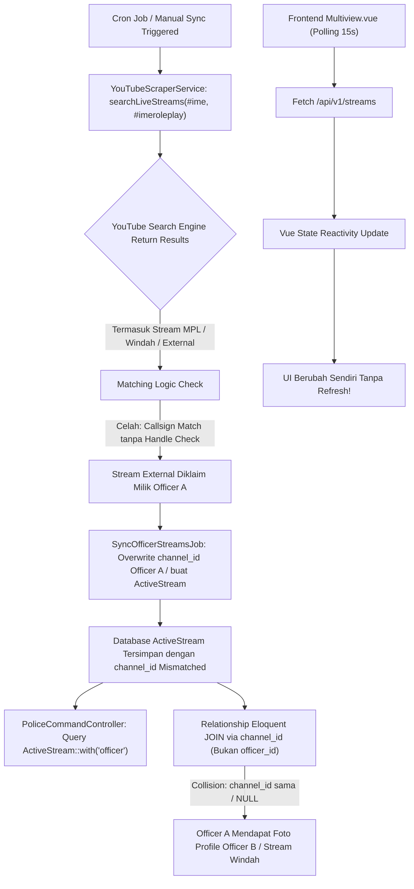

# Analisis Kebocoran Data & Rencana Perbaikan Issue Stream Sync (Desynchronization Analysis & Plan)

Dokumen ini memuat analisis mendalam mengenai masalah ketidakcocokan data (*data desynchronization*), pengalihan link streaming ke pihak ketiga (seperti Windah / MPL), pergeseran foto profil officer, serta perubahan status *live* yang muncul secara tiba-tiba tanpa *refresh* halaman.

---

## 1. Ringkasan Akar Masalah (Executive Summary)

Berdasarkan investigasi terhadap kode program di backend Laravel dan frontend Vue/Inertia, ditemukan **5 Akar Masalah Utama** yang saling memperparah satu sama lain:

| No | Gejala yang Dirasakan User | Penyebab Utama di Level Kode | Komponen Terdampak |
|---|---|---|---|
| **1** | Buka stream officer tapi malah lari ke Windah / MPL | Scraper melakukan pencarian Hashtag global (`#ime`, `#imeroleplay`) & melakukan *matching* longgar berdasarkan Callsign tanpa verifikasi `channel_id` atau `handle` yang valid. | `YouTubeScraperService.php` |
| **2** | Foto profil Officer A tertukar dengan Officer B di halaman tertentu | Relasi tabel `ActiveStream` terikat ke `Officer` menggunakan `channel_id` (string), **BUKAN `officer_id` (Primary Key)**. Ketika 2 officer memiliki `channel_id` bernilai `NULL`, kosong `""`, atau ter-overwrite ID yang sama, Eloquent `JOIN` mengambil officer pertama yang cocok secara acak. | `ActiveStream.php`, `Officer.php`, Migration `active_streams` |
| **3** | Officer B offstream mendadak *LIVE* menampilkan Youtuber H | Job sync otomatis meng-update kolom `channel_id` officer di database dengan ID channel YouTube dari hasil deteksi *scraper* yang salah (*false positive*). | `SyncOfficerStreamsJob.php` |
| **4** | Data berubah-ubah sendiri tanpa di-*refresh* | Frontend `Multiview.vue` menjalankan *silent polling* (`setInterval`) setiap 15 detik ke `/api/v1/streams`. Begitu background job memasukkan data hasil *sync* yang keliru ke DB, API langsung mengirimkan payload terkorupsi dan Vue merender ulang komponen secara *real-time*. | `Multiview.vue`, `PoliceCommandController.php` |
| **5** | Pengalihan URL YouTube `@handle/live` | Endpoint YouTube `@handle/live` sering melakukan *302 Redirect* ke siaran unggulan kanal (*Featured Stream / Premiere*) meskipun pemilik kanal sebenarnya sedang *Offline*. Scraper menangkap `video_id` tersebut sebagai siaran *Live*. | `YouTubeScraperService.php` |

---

## 2. Diagram Alur Terjadinya Error (Data Desync Flowchart)



---

## 3. Bedah Celah Kode Detail (Deep-Dive Code Audit)

### Celah 1: Logic Matching Longgar & Matching Callsign Tanpa Handle Check
**Lokasi File:** [`YouTubeScraperService.php`](file:///c:/Development/laragon/www/ime-police-multiview/app/Services/YouTubeScraperService.php#L73-L113)

```php
// Baris 107-112 pada YouTubeScraperService.php
if (!empty($callsign) && strlen($callsign) >= 6 && preg_match('/\b' . preg_quote($callsign, '/') . '\b/i', $title)) {
    if (empty($streamHandle) || $streamHandle === $cleanHandle) {
        $matchedStream = $stream;
        break;
    }
}
```
* **Masalah:** Jika scraping HTML YouTube gagal mengekstrak `@handle` channel pencarian (sehingga `$streamHandle` bernilai `empty`), dan judul stream publik mengandung kata yang sama dengan Callsign Officer (misal kata `POLICE`, `PATROL`, `SHERIFF`, `ROOKIE`), maka video stream mana pun yang memiliki kata tersebut (termasuk MPL/Windah) akan **langsung dicocokkan sebagai stream resmi officer tersebut**!

---

### Celah 2: Relasi Foreign Key Menggunakan `channel_id` (String) Bukan `officer_id` (BigInt)
**Lokasi File:** 
- Migration: [`2026_09_08_000002_create_active_streams_table.php`](file:///c:/Development/laragon/www/ime-police-multiview/database/migrations/2026_09_08_000002_create_active_streams_table.php#L26-L29)
- Model Officer: [`Officer.php`](file:///c:/Development/laragon/www/ime-police-multiview/app/Models/Officer.php#L82-L92)
- Model ActiveStream: [`ActiveStream.php`](file:///c:/Development/laragon/www/ime-police-multiview/app/Models/ActiveStream.php#L33-L36)

```php
// Pada ActiveStream.php
public function officer(): BelongsTo {
    return $this->belongsTo(Officer::class, 'channel_id', 'channel_id');
}
```
* **Masalah:** `channel_id` adalah *identifier* string dari pihak ketiga (YouTube). Jika ada 2 officer yang memiliki `channel_id` bermasalah/placeholder/kosong, query `ActiveStream::with('officer')` akan memasangkan siaran live ke officer pertama yang ditemukan oleh SQL engine. Ini menyebabkan **foto profil tertukar** antara Halaman Officer Directory vs Halaman Multiview Dashboard.

---

### Celah 3: Overwrite Otomatis Kolom `channel_id` Officer di Background Job
**Lokasi File:** [`SyncOfficerStreamsJob.php`](file:///c:/Development/laragon/www/ime-police-multiview/app/Jobs/SyncOfficerStreamsJob.php#L49-L51)

```php
if ((empty($officer->channel_id) || str_starts_with($officer->channel_id, 'custom-')) 
    && !empty($liveData['channel_id']) 
    && in_array($liveData['detection_method'] ?? '', ['DIRECT_HANDLE', 'RSS_FEED'])) {
    $officer->update(['channel_id' => $liveData['channel_id']]);
}
```
* **Masalah:** Ketika scraper mendeteksi `liveData` dari pencarian yang salah, job ini secara otomatis memperbarui `officer.channel_id` di database dengan `channel_id` milik Youtuber H/MPL/Windah secara permanen! Dampaknya, ketika Youtuber H streaming lagi di kemudian hari, Officer B ikut dianggap *LIVE*.

---

### Celah 4: Filtering Officer Live di Controller yang Membocorkan Data Kosong
**Lokasi File:** [`PoliceCommandController.php`](file:///c:/Development/laragon/www/ime-police-multiview/app/Http/Controllers/PoliceCommandController.php#L523-L524)

```php
$isLive = in_array($officer->channel_id, $liveChannelIds);
$liveStream = $isLive ? $activeStreams->firstWhere('channel_id', $officer->channel_id) : null;
```
* **Masalah:** Jika `$liveChannelIds` berisi string kosong `""` atau `null` (dari stream anonim/unassigned), maka seluruh officer yang belum diset `channel_id`-nya akan terdeteksi `$isLive = true`, lalu semuanya mengambil `$liveStream` yang sama!

---

### Celah 5: Silent Background Polling Tanpa Validasi Invariansi
**Lokasi File:** [`Multiview.vue`](file:///c:/Development/laragon/www/ime-police-multiview/resources/js/Pages/Multiview.vue#L281-L348)

```js
streamPollInterval = setInterval(fetchLiveStreamsSilently, 15000);
```
* **Masalah:** Setiap 15 detik, komponen Vue memanggil `/api/v1/streams` dan memperbarui `streams.value` tanpa mengecek apakah `officer_id` atau `video_id` tersebut konsisten dengan state sebelumnya. Ketika backend menghasilkan data desync, UI secara dinamis berganti streamer di depan mata pengguna tanpa perlunya *page reload*.

---

## 4. Rencana Langkah Perbaikan Komprehensif (Actionable Resolution Plan)

### Tahap 1: Restrukturisasi Skema Database & Relasi Model
1. **Tambahkan Kolom `officer_id` pada Tabel `active_streams`**:
   - Buat migrasi baru untuk menambahkan `officer_id` (foreign key `unsignedBigInteger` terhubung ke `officers.id` ON DELETE CASCADE).
   - Ubah relasi `Officer::hasOne(ActiveStream::class, 'officer_id')` dan `ActiveStream::belongsTo(Officer::class, 'officer_id')`.
2. **Kunci Ketaatan Relasi**:
   - Menghilangkan ketergantungan relasi utama pada string `channel_id`.
   - Menjamin bahwa 1 `ActiveStream` secara eksplisit dan absolut dimiliki oleh 1 `officer_id`.

### Tahap 2: Pembatasan Strict Scraper Matching & Blacklisting Pihak Ketiga
1. **Verifikasi Striktif Kepemilikan Stream**:
   - Hapus **Match Priority 4 (Callsign matching)** jika `streamHandle` kosong.
   - Hanya izinkan matching jika **YouTube Channel ID** atau **Canonical Handle (`@handle`)** persis 100% sama dengan data officer yang terdaftar di database.
2. **Kunci Mati Channel ID (Canonical Channel Lockdown)**:
   - Hapus fitur auto-update `channel_id` dari scraper yang tidak tervalidasi pada `SyncOfficerStreamsJob.php`.
   - Admin harus menginput/memverifikasi `channel_id` asli (contoh: `UC...`) saat mendaftarkan officer.
3. **Pemberlakuan Blacklist Global**:
   - Daftarkan ID/Handle channel publik non-community (MPL Indonesia, Windah Basudara, dll) ke dalam daftar `blacklistedChannels` agar tidak pernah ter-sync secara tak sengaja.
4. **Deteksi Redirect Hijack (`@handle/live`)**:
   - Tambahkan verifikasi HTML bahwa stream yang didapat dari `youtube.com/@handle/live` benar-benar milik channel tersebut (memeriksa `channelId` dari player microformat) dan bukan redirect ke stream orang lain.

### Tahap 3: Perbaikan Query Controller & API
1. **Update `PoliceCommandController.php`**:
   - Mengubah seluruh query `$liveChannelIds` menjadi berbasis `$liveOfficerIds = ActiveStream::where('status', 'LIVE')->pluck('officer_id')->toArray()`.
   - Memastikan tidak ada stream anonim atau stream dengan `officer_id = NULL` yang masuk ke roster officer resmi.

### Tahap 4: Stabilisasi Client-Side Vue Polling
1. **Validasi Invariansi pada `fetchLiveStreamsSilently`**:
   - Saat melakukan merging data `streams.value`, cocokkan berdasarkan `officer.id`, bukan hanya `video_id`.
   - Jika terjadi perubahan `video_id` untuk `officer.id` yang sama, berikan transisi yang mulus atau verifikasi ulang ke server sebelum merender ulang player iFrame YouTube.

---

## 5. Ringkasan Checklist Eksekusi Perbaikan

- [ ] **Migrasi Database**: `add_officer_id_to_active_streams_table.php`
- [ ] **Update Model**: Fix relasi `Officer` & `ActiveStream` menggunakan `officer_id`
- [ ] **Refactor Scraper**: Perketat matching di `YouTubeScraperService::syncAllActiveOfficers` & perbaiki `isPolicePatrolStream`
- [ ] **Fix Background Job**: Hapus auto-overwrite `channel_id` di `SyncOfficerStreamsJob.php`
- [ ] **Fix Controller**: Update `PoliceCommandController.php` (dashboard, multiview, apiStreams, officers)
- [ ] **Sanitasi Data DB Exisiting**: Jalankan script pembersihan data `active_streams` & perbaiki `channel_id` officer yang korup
- [ ] **Testing & Verifikasi**: Jalankan manual sync `php artisan officer:sync` dan pastikan tidak ada data silang
