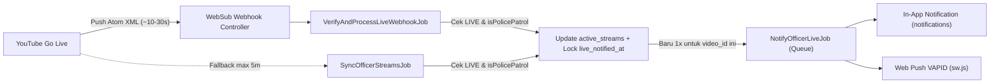

# Rencana Teknis: Notifikasi Perwira Live (Opsi A — YouTube WebSub + Web Push PWA)

Dokumen ini merangkum arsitektur, skema database, alur deteksi cepat (< 1 menit, gratis), dan pembagian task untuk fitur notifikasi ketika perwira yang diikuti (*subscribe/follow*) oleh user mulai live patroli.

---

## 1. Keputusan Produk yang Disepakati
- **Akses Pengguna**: Wajib login (user terautentikasi) agar langganan sinkron antar-perangkat, mendukung In-App Bell + Web Push, dan aman dari spam.
- **Lingkup Follow**: Follow per-perwira (tombol Follow / Lonceng pada perwira).
- **Deteksi Live**: **YouTube WebSub (PubSubHubbub)** untuk deteksi real-time (~10–30 detik) dengan **fallback** ke scheduler `officer:sync` (5 menit) yang sudah ada.
- **Kanal Notifikasi (MVP)**: **Web Push Notification (PWA Service Worker + VAPID)** dan **In-App Notification Center (Ikon Lonceng di Navbar)**.

---

## 2. Arsitektur End-to-End

### Mengapa Tetap Gratis & Aman dari Rate-Limit?
1. **YouTube WebSub** (`https://pubsubhubbub.appspot.com/subscribe`) gratis tanpa kuota YouTube Data API; YouTube yang menghubungi server kita saat ada video/live baru pada channel `UC...`.
2. **Web Push (VAPID)** gratis tanpa layanan berbayar (Firebase/OneSignal); server PHP mengirim payload terenkripsi langsung ke push service bawaan browser.
3. **Fallback Aman**: `SyncOfficerStreamsJob` tetap berjalan tiap 5 menit untuk menangkap channel yang belum punya `UC...` ID atau jika webhook sempat terlewat.

---

## 3. Skema Database

1. **`officer_subscriptions`** (relasi follow user ↔ officer)
   - `id`, `user_id` (FK `users`, cascade), `officer_id` (FK `officers`, cascade)
   - `notify_in_app` (boolean, default `true`)
   - `notify_web_push` (boolean, default `true`)
   - `created_at`, `updated_at`
   - Unique index: `['user_id', 'officer_id']`

2. **`push_subscriptions`** (endpoint Web Push per perangkat/browser user)
   - `id`, `user_id` (FK `users`, cascade)
   - `endpoint` (`text`), `endpoint_hash` (`string(64)`, unique)
   - `public_key` (`string`), `auth_token` (`string`), `content_encoding` (`string`, default `'aes128gcm'`)
   - `user_agent` (`string`, nullable), `last_used_at` (`timestamp`, nullable)
   - `created_at`, `updated_at`

3. **`youtube_websub_subscriptions`** (status lease langganan WebSub ke YouTube)
   - `id`, `officer_id` (FK `officers`, cascade, unique)
   - `channel_id` (`string`, index)
   - `callback_token` (`string(64)`) — token verifikasi per-channel pada callback URL
   - `status` (`string`: `pending`, `active`, `expired`, `failed`)
   - `lease_seconds` (`integer`, nullable)
   - `expires_at` (`timestamp`, nullable, index)
   - `last_verified_at`, `last_notification_at` (`timestamp`, nullable)
   - `last_error` (`text`, nullable)
   - `created_at`, `updated_at`

4. **`notifications`** (tabel standar Laravel `DatabaseNotification`)
   - Menyimpan notifikasi in-app untuk user (`type`, `notifiable_type`, `notifiable_id`, `data`, `read_at`, timestamps).

5. **Kolom baru di `active_streams`**
   - `live_notified_at` (`timestamp`, nullable) — kunci deduplikasi agar satu `video_id` tidak memicu notifikasi berulang jika webhook & cron berjalan berdekatan atau stream sempat *reconnect*.

---

## 4. Rancangan Komponen Teknis

### A. YouTube WebSub (`YouTubeWebSubService` & `YouTubeWebSubController`)
- **Rute Publik (tanpa CSRF)**:
  - `GET /webhooks/youtube/websub/{officer}`: Validasi `token` query + `hub.mode` (`subscribe`/`unsubscribe`) + `hub.topic`, lalu balas plain-text `hub.challenge` (HTTP 200) dan set status `active` + `expires_at`.
  - `POST /webhooks/youtube/websub/{officer}`: Validasi `token` / HMAC `X-Hub-Signature` (jika secret dipakai), parse Atom XML (`yt:videoId`, `yt:channelId`, `title`), abaikan jika `<at:deleted-entry>`, lalu dispatch `VerifyAndProcessLiveWebhookJob` dan segera balas `204 No Content`.
- **Scheduler (`websub:sync`)**:
  - Dijadwalkan tiap 6 jam di `routes/console.php` untuk mendaftarkan officer baru yang memiliki `channel_id` berawalan `UC` dan memperpanjang lease yang `expires_at < now()->addDay()`.
- **Kebutuhan Produksi**: Domain wajib HTTPS publik agar Google PubSubHubbub dapat memanggil callback URL.

### B. Verifikasi & Deduplikasi (`VerifyAndProcessLiveWebhookJob` & `SyncOfficerStreamsJob`)
- Webhook YouTube juga terpicu untuk video upload biasa atau stream *upcoming*. Karena itu `VerifyAndProcessLiveWebhookJob` wajib memanggil `YouTubeScraperService::getBatchStreamsTelemetry([$videoId])` dan `isPolicePatrolStream(...)` sebelum menandai stream sebagai `LIVE`.
- Sebelum mengirim notifikasi, lakukan transaksi dengan `lockForUpdate()` pada baris `active_streams` (`officer_id`, `video_id`):
  - Jika `live_notified_at !== null`, lewati (sudah pernah dikirim).
  - Jika masih `null`, isi `live_notified_at = now()` lalu dispatch `NotifyOfficerLiveJob($officer->id, $activeStream->id)`.

### C. Pengiriman Notifikasi (`NotifyOfficerLiveJob`)
- Gunakan package `minishlink/web-push` (PHP VAPID) dan konfigurasi `VAPID_PUBLIC_KEY`, `VAPID_PRIVATE_KEY`, `VAPID_SUBJECT` di `.env` / `config/services.php`.
- Ambil subscriber dari `officer_subscriptions` secara `chunkById(200)`:
  - Simpan `OfficerLiveNotification` (`DatabaseNotification`) jika `notify_in_app = true`.
  - Kirim Web Push ke semua `push_subscriptions` milik user jika `notify_web_push = true`.
  - Hapus otomatis baris `push_subscriptions` jika push service mengembalikan status `404` atau `410` (subscription kedaluwarsa/dicabut user).

### D. Frontend (Tactical UI Kit)
- **Service Worker (`public/sw.js`)**:
  - Event `push`: parse payload JSON (`title`, `body`, `icon`, `badge`, `data.url`) dan tampilkan via `self.registration.showNotification(...)`.
  - Event `notificationclick`: tutup notif, fokuskan tab website jika sudah terbuka, atau buka `data.url` (`/watch/{video_id}` atau `/multiview`).
- **Tombol Follow / Lonceng**:
  - Komponen reusable (mis. `OfficerSubscribeButton.vue`) di `OfficerDirectory.vue`, `BioLink.vue`, dan `Watch.vue`. Jika belum login, arahkan ke modal/halaman login.
- **Navbar Notification Bell (`NotificationBell.vue`)**:
  - Ikon lonceng dengan badge jumlah unread, popover/dropdown daftar notifikasi live terbaru, aksi "Tandai semua dibaca", dan toggle cepat untuk mengaktifkan/nonaktifkan Web Push di perangkat saat ini.

---

## 5. Pembagian Task Implementasi (Bertahap)

| ID | Fokus | Cakupan Utama |
| :--- | :--- | :--- |
| **LN-01** | Fondasi Database & Model | Migrasi `officer_subscriptions`, `push_subscriptions`, `youtube_websub_subscriptions`, `notifications`, `active_streams.live_notified_at`, beserta model & relasi di `User`/`Officer`. |
| **LN-02** | API Follow Perwira | Controller & rute `POST/DELETE /api/v1/officers/{officer}/subscribe`, `GET /api/v1/subscriptions` + Feature Test (auth, toggle, validasi). |
| **LN-03** | YouTube WebSub | `YouTubeWebSubService`, `YouTubeWebSubController` (`GET`/`POST` Atom XML), command `websub:sync`, scheduler + Feature Test (Http::fake & XML payload). |
| **LN-04** | Verifikasi, Deduplikasi & In-App Notif | `VerifyAndProcessLiveWebhookJob`, integrasi trigger + `lockForUpdate()` di `SyncOfficerStreamsJob`, `NotifyOfficerLiveJob`, `OfficerLiveNotification`, & API daftar/read notifikasi + Test anti-duplikasi. |
| **LN-05** | Web Push Backend (VAPID) | Integrasi `minishlink/web-push`, `PushSubscriptionController` (store/delete/test), pengiriman di `NotifyOfficerLiveJob`, auto-cleanup `404/410` + Test. |
| **LN-06** | Frontend UI & Service Worker | Update `public/sw.js`, composable `usePushNotifications.js`, `NotificationBell.vue` di Navbar, dan `OfficerSubscribeButton.vue` di Directory / BioLink / Watch (mematuhi `GEMINI-UI-PLAYBOOK.md`). |
